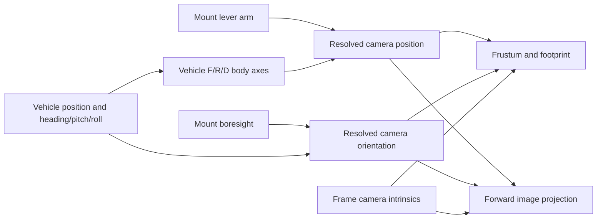
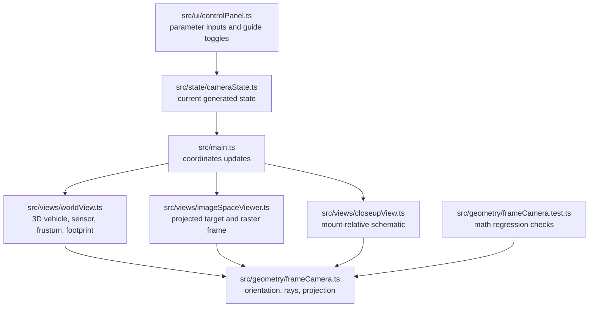

# Frame Camera Orientation Simulator using ArcGIS

A browser-based proof of concept for inspecting how a vehicle, its camera mount, frame-camera
intrinsics, and a flat ground reference work together. It uses the ArcGIS Maps SDK for JavaScript
to make the geometric consequences of an orientation change visible in a 3D scene and two linked
diagrams.

This is a teaching and exploration tool, not a production camera-calibration, navigation, or
orthorectification system. It simplifies terrain to a plane, omits lens distortion and timing
effects, and uses illustrative vehicle and target models. Treat the views as a way to reason about
the orientation model before applying it to operational imagery or FMV data.

## What it demonstrates

- Esri-style camera heading, pitch, and roll in a local East-North-Up (ENU) frame.
- A camera mount resolved from a vehicle body-frame lever arm and mount boresight.
- Frame-camera field of view, principal point offsets, and image rotation.
- A camera frustum and its intersection with a flat ground plane.
- Forward projection of a sample target into image coordinates.
- The relationship between Esri camera orientation and photogrammetric omega, phi, kappa.

## Orientation model

The world frame is local ENU meters: $x$ is East, $y$ is North, and $z$ is Up. Camera heading is
clockwise from North. Camera pitch is $0^\circ$ at nadir, $90^\circ$ at the horizon, and
$180^\circ$ at zenith. Roll is rotation about the boresight.

The mount first translates from the vehicle reference point using its Forward, Right, Down lever
arm. Its boresight is then composed with the vehicle orientation to obtain the resolved camera
position and orientation used by the frustum and image projection.



## Project map



The diagrams are Mermaid source and render natively in GitHub. They also keep the code-to-behavior
mapping close to the documentation, so the diagrams can change with the implementation.

## Run locally

```powershell
npm.cmd ci
npm.cmd run dev
```

Run the production checks with:

```powershell
npm.cmd run build
npm.cmd test
```

See [DEPLOYMENT.md](DEPLOYMENT.md) for GitHub Pages publishing and [docs/user-guide.md](docs/user-guide.md)
for the interaction guide.