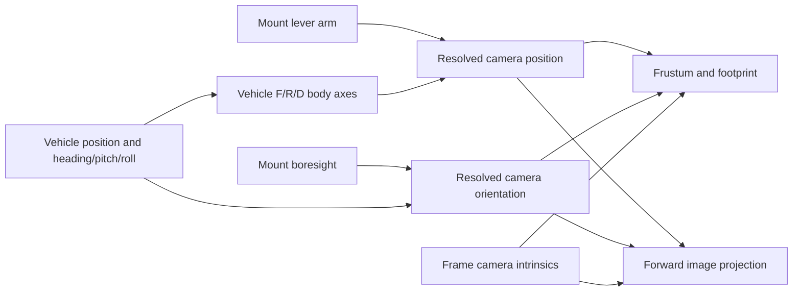
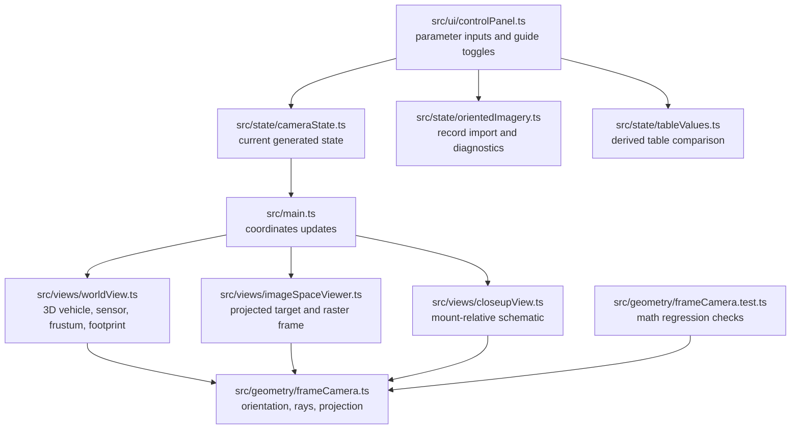

# Frame Camera Orientation Simulator using ArcGIS

A browser-based proof of concept for inspecting how a vehicle, its camera mount, frame-camera
intrinsics, and a flat ground reference work together. It uses the ArcGIS Maps SDK for JavaScript
to make the geometric consequences of an orientation change visible in a 3D scene and two linked
diagrams.

This is a teaching and exploration tool, not a production camera-calibration, navigation, or
orthorectification system. It simplifies terrain to a plane, omits lens distortion and timing
effects, and uses illustrative vehicle and target models. Treat the views as a way to reason about
the orientation model before applying it to operational imagery or FMV data.

## What it demonstrates

- Esri-style camera heading, pitch, and roll in a local East-North-Up (ENU) frame.
- A camera mount resolved from a vehicle body-frame lever arm and mount boresight.
- Frame-camera field of view, principal point offsets, and image rotation.
- A camera frustum and its intersection with a flat ground plane.
- Forward projection of a sample target into image coordinates.
- Import of oriented imagery records for exploring camera settings and synthetic image-to-ground shifts.
- Read-only comparisons of resolved camera values using Frame Camera and Oriented Imagery field names.

## Explore the simulator

1. Change vehicle, sensor mount, or camera parameters and select **Generate**. Compare the current
  frustum and target projection with the previous generated state.
2. Click the ground in the 3D view to move the vehicle relative to the fixed sample target. Use the
  image-space view and the close-up diagram to inspect the resulting camera pose and projection.
3. Open **Camera table values** to compare derived Frame Camera or Oriented Imagery fields. The
  table describes the last generated camera, not pending slider changes.
4. Open **Import Oriented Imagery Record** to paste or load JSON, CSV, or a `CameraOrientation`
  string, or find a record by ObjectID in an accessible oriented imagery layer. Review and select
  fields before applying a record. Secured layers may require sign-in configuration that this app
  does not currently provide.
5. Select a point in the synthetic image, change parameters, and generate again to compare its
  estimated ground position and east/north shift. This does not project the original photograph.

See the [user guide](docs/user-guide.md) for detailed controls, import behavior, and limitations.

## Camera table limitations

The comparison displays local ENU coordinates, not georeferenced table coordinates, and is not an
export-ready record. Camera position and orientation include the vehicle's sensor mount; camera
height is measured above the simulator's flat ground plane. By default, the vehicle is at
`(0, 0, 120)` m and its mount places the camera at `(0, 1.7, 115)` m.

Omega, phi, and kappa are intentionally unavailable in the Frame Camera comparison: the
simulator's illustrative conversion has not been independently verified against Esri's conventions.
The existing round-trip tests check internal consistency, not Esri compatibility. Image rotation is
also an approximation, not a verified Esri viewer transform.

## Orientation model

The world frame is local ENU meters: $x$ is East, $y$ is North, and $z$ is Up. Camera heading is
clockwise from North. Camera pitch is $0^\circ$ at nadir, $90^\circ$ at the horizon, and
$180^\circ$ at zenith. Roll is rotation about the boresight.

The mount first translates from the vehicle reference point using its Forward, Right, Down lever
arm. Its boresight is then composed with the vehicle orientation to obtain the resolved camera
position and orientation used by the frustum and image projection.



## Project map



The diagrams are Mermaid source and render natively in GitHub. They also keep the code-to-behavior
mapping close to the documentation, so the diagrams can change with the implementation.

## Run locally

Install Node.js 22 and npm, then run these commands from the repository root on Windows:

```powershell
npm.cmd ci
npm.cmd run dev
```

Open the local URL printed by Vite. Run the tests and production build with:

```powershell
npm.cmd test
npm.cmd run build
```

The production site is built into `dist/`; the source files cannot be deployed directly as a static
site. Pushing `main` triggers the configured GitHub Pages and Meridian workflows, but does not
update S3. For local S3 uploads using `deploy-s3.ps1`, prerequisites, and hosting details, see
[DEPLOYMENT.md](DEPLOYMENT.md).